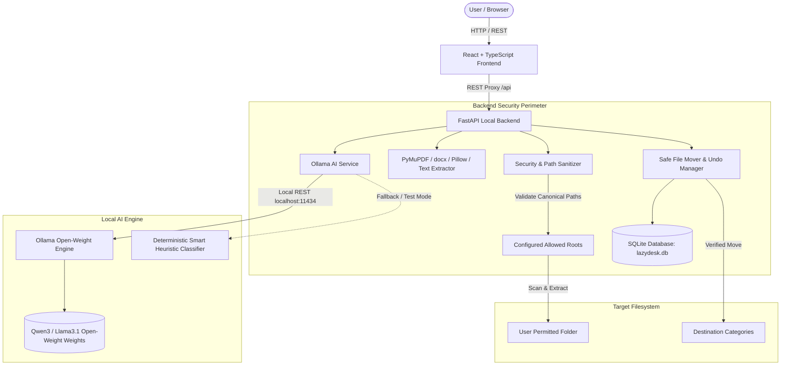

# LazyDesk AI — Your Local AI File Organizer

> **"Stop organizing files manually. Let your local AI do the boring work."**  
> Built for the **Hacktoberfest Open-Source AI Challenge Week 3: Slow and Steady**.

[](LICENSE)
[](https://www.python.org/)
[](https://fastapi.tiangolo.com/)
[](https://vitejs.dev/)
[-black.svg)](https://ollama.com/)

---

## 1. Product Overview

**LazyDesk AI** is a local-first, privacy-respecting intelligent file organizer. 

Every day, developers, students, freelancers, and office workers end up with cluttered "Downloads", "Desktop", and project directories filled with cryptically named files like `INV-98234-billing-oct.txt`, `CS204_Fall2024_Syllabus.pdf`, `screenshot_dashboard_v1.png`, and `Freelance_Consulting_Agreement_Draft.docx`. Sorting, renaming, and filing them manually is tedious and procrastinated on.

LazyDesk AI automates this repetitive chore using **open-weight local AI** (via Ollama):
1. **Scans** a permitted folder on your local drive.
2. **Safely extracts** text summaries locally from PDFs, Word DOCX documents, Markdown notes, CSVs, and image metadata.
3. **Infers purpose** using local open-weight models (such as `qwen3` or `llama3.1`).
4. **Suggests** clear, standardized filenames and destination categories (`Finance`, `Work`, `Education`, `Projects`, `Documents`, `Images`, `Notes`, `Other`).
5. **Presents a preview table** requiring explicit human approval.
6. **Executes safe file moves** with zero silent overwrites, while recording SHA-256 hashes for **instant, safe undo**.

---

## 2. Hacktoberfest Week 3 Alignment: "Slow and Steady"

LazyDesk AI directly embodies the **Slow and Steady** ethos:
- **Rewards Productive Laziness**: Eliminates the manual drag of opening, inspecting, and moving files one by one.
- **100% Local Open-Weight Inference**: Runs via Ollama on your machine without incurring commercial API bills, subscriptions, or vendor lock-in.
- **Human-in-the-Loop & Deliberate Control**: AI suggestions are treated as untrusted proposals. You review, edit, approve, or exclude before any file moves.
- **Transactional Safety & Reversibility**: Moves can be rolled back anytime using the recorded SHA-256 integrity logs.
- **Zero Document Leakage**: Document contents, financial records, and personal notes never leave `localhost`.

---

## 3. Architecture & Trust Model



### Filesystem Trust Model & Security Guardrails
Browsers cannot safely read or modify arbitrary local directories. LazyDesk AI enforces a strict backend security boundary:
- **Configured Allowed Roots**: The backend will only interact with folders strictly inside `ALLOWED_ROOTS`. Any request targeting paths outside these roots is rejected with HTTP 400.
- **Canonical Path Resolution**: Uses `os.path.realpath` to resolve symbolic links and ensure targets do not escape allowed roots.
- **Path Traversal Protection**: Blocks traversal attempts (`..`, `../`, null bytes `\0`).
- **Symlink Protection**: Refuses to scan or move symbolic links to avoid directory recursion or system link exploits.
- **OS Filename Sanitization**: Strips illegal characters (`\ / : * ? " < > |`) and avoids Windows reserved device names (`CON`, `PRN`, `AUX`, `NUL`, `COM1-9`, `LPT1-9`).
- **Zero Silent Overwrites**: If a file with the destination name exists, LazyDesk assigns a non-destructive unique suffix like `Document (1).pdf`.
- **Integrity-Checked Undo**: Pre-move and post-move SHA-256 hashes are recorded in SQLite. Undo validates that the file has not been modified and that the original location is free.

---

## 4. Supported Document Types

| Format | File Types | Extraction Engine | Details |
|---|---|---|---|
| **PDF** | `.pdf` | PyMuPDF (`pymupdf`) | Streams bounded text page-by-page up to 4,000 characters; encrypted PDF detection. |
| **Word DOCX** | `.docx` | `python-docx` | Extracts structured paragraph text up to bounded character limit. |
| **Plain Text & Notes** | `.txt`, `.md` | Python I/O | Reads UTF-8 (with latin-1 fallback) for code, journals, and checklists. |
| **Data Records** | `.csv` | Python I/O | Parses structured tabular records and expenses. |
| **Images & Media** | `.png`, `.jpg`, `.jpeg`, `.gif`, `.webp`, `.svg` | Pillow (`PIL`) | Extracts safe metadata (dimensions, format, color mode, file size). **No visual hallucinations.** |

---

## 5. Prerequisites

- **OS**: Windows 10/11, macOS, or Linux
- **Python**: Python 3.11, 3.12, or 3.13
- **Node.js**: Node.js v18+ (tested with Node v26)
- **Local AI**: [Ollama](https://ollama.com/) installed and running locally

---

## 6. Windows Setup & Quick Start

### Step 1: Clone & Open the Workspace
```powershell
cd C:\Users\ayush\OneDrive\Desktop\Hacktober\dev4
```

### Step 2: Configure Ollama & Download Model
1. Install Ollama from [ollama.com](https://ollama.com/).
2. Start the Ollama daemon:
   ```powershell
   ollama serve
   ```
3. Pull your preferred open-weight model:
   ```powershell
   ollama pull qwen3
   # or pull llama3.1
   ollama pull llama3.1
   ```
*(Note: If Ollama is not installed or your system has limited RAM, LazyDesk AI automatically provides a deterministic Smart Mock Mode that passes all tests and functions offline!)*

### Step 3: Backend Setup
```powershell
# Create Python virtual environment
python -m venv backend/.venv

# Activate virtual environment
backend\.venv\Scripts\Activate.ps1

# Install dependencies
python -m pip install -r backend/requirements.txt

# Run backend automated test suite
backend\.venv\Scripts\pytest backend\tests -v

# Seed realistic test documents for instant testing
backend\.venv\Scripts\python scripts/seed_sample_folder.py

# Start FastAPI backend server (Runs on http://localhost:8000)
backend\.venv\Scripts\python -m uvicorn backend.main:app --host 127.0.0.1 --port 8000 --reload
```

### Step 4: Frontend Setup
In a new terminal window:
```powershell
cd C:\Users\ayush\OneDrive\Desktop\Hacktober\dev4\frontend

# Install frontend dependencies
npm install

# Test production build
npm run build

# Start Vite development server (Runs on http://localhost:5173)
npm run dev
```

Open your browser to: **`http://localhost:5173`**

---

## 7. Guided Demonstration (Try it in 60 Seconds!)

1. **Dashboard**: Observe real-time stats from SQLite and live Ollama connectivity.
2. Click **"Organize My Files"** or navigate to **"Scan & Organize"**.
3. Use the pre-filled path for **`sample_messy_folder`** (seeded in Step 3), or click **"Browse Folders"** to pick any folder within your workspace.
4. Click **"Scan Folder"**: LazyDesk detects the files, extracts text snippets locally, and verifies their sizes.
5. Click **"Analyze with Local AI"**: The open-weight model infers document purpose and assigns categories:
   - `INV-98234-billing-oct.txt` &rarr; `Finance/Invoice_Record.txt`
   - `CS204_Fall2024_Syllabus.pdf` &rarr; `Education/Course_Syllabus.pdf`
   - `distributed_cache_design_doc.pdf` &rarr; `Projects/Project_Documentation.pdf`
   - `Freelance_Consulting_Agreement_Draft.docx` &rarr; `Work/Executed_Agreement.docx`
   - `screenshot_dashboard_v1.png` &rarr; `Images/image_screenshot_dashboard_v1.png`
6. **Review Suggestions**: Inline-edit proposed filenames, tweak categories via dropdown, or exclude files.
7. Click **"Preview Approved Changes"**: Inspect the exact validated source and destination paths.
8. Check the explicit confirmation box and click **"Execute Approved Moves"**.
9. Go to **"Operation History"** and click **"Undo All"** or individual **"Undo"**: Watch the files restore safely to their exact initial positions with verified SHA-256 checksums!

---

## 8. API Documentation

| Method | Endpoint | Description |
|---|---|---|
| `GET` | `/api/health` | Healthcheck returning application name and version. |
| `GET` | `/api/ai/status` | Queries Ollama daemon health, active model, and available models. |
| `POST` | `/api/folders/validate` | Validates directory existence, permissions, and allowed-roots boundary. |
| `POST` | `/api/folders/browse` | Returns safe subdirectories within configured allowed roots. |
| `POST` | `/api/scan` | Scans target folder, extracts previews, and generates session records. |
| `POST` | `/api/analyze` | Sends document contexts to Ollama for structured JSON suggestions. |
| `PATCH` | `/api/files/{id}` | Updates proposed filename, category, or approval state. |
| `POST` | `/api/operations/preview` | Generates verified action table with collision checks before mutation. |
| `POST` | `/api/operations/execute` | Atomically executes approved file operations and logs SHA-256 hashes. |
| `GET` | `/api/operations` | Returns chronological batch logs with success/failure counts. |
| `GET` | `/api/operations/{id}` | Returns individual file movements within a batch. |
| `POST` | `/api/operations/{id}/undo` | Reverts a single file move after verifying destination and hash. |
| `POST` | `/api/operations/batches/{id}/undo` | Reverts all successful operations in an entire batch. |
| `GET` | `/api/dashboard/stats` | Aggregates real DB metrics for scanned, reviewed, and undoable files. |
| `GET` | `/api/settings` | Returns active allowed roots, model names, and limits. |
| `PUT` | `/api/settings` | Updates active model, Ollama URL, mock mode, or adds allowed roots. |

Interactive OpenAPI documentation is available live at: **`http://localhost:8000/docs`**.

---

## 9. Verification & Automated Test Results

The automated test suite runs with **pytest** and tests all critical filesystem and AI pathways without requiring an internet connection or an active Ollama process:

```
============================= test session starts =============================
platform win32 -- Python 3.13.5, pytest-9.1.1
collected 13 items

backend/tests/test_lazydesk.py::test_health_endpoint PASSED              [  7%]
backend/tests/test_lazydesk.py::test_ai_status PASSED                    [ 15%]
backend/tests/test_lazydesk.py::test_folder_validation_allowed_root PASSED [ 23%]
backend/tests/test_lazydesk.py::test_rejection_outside_permitted_roots PASSED [ 30%]
backend/tests/test_lazydesk.py::test_path_traversal_rejection PASSED     [ 38%]
backend/tests/test_lazydesk.py::test_filename_sanitization PASSED        [ 46%]
backend/tests/test_lazydesk.py::test_extractor_text PASSED               [ 53%]
backend/tests/test_lazydesk.py::test_mock_ai_analysis PASSED             [ 61%]
backend/tests/test_lazydesk.py::test_invalid_model_fallback PASSED       [ 69%]
backend/tests/test_lazydesk.py::test_scan_preview_execution_flow PASSED  [ 76%]
backend/tests/test_lazydesk.py::test_undo_operation_flow PASSED          [ 84%]
backend/tests/test_lazydesk.py::test_undo_conflict_handling PASSED       [ 92%]
backend/tests/test_lazydesk.py::test_operation_history_api PASSED        [100%]

======================== 13 passed in 5.95s ========================
```

Frontend production build verification (`npm run build`):
```
✓ 1939 modules transformed.
dist/index.html                   0.99 kB
dist/assets/index-Dox0UFg3.css   38.39 kB
dist/assets/index-i3oRLHJv.js   332.67 kB
✓ built in 1.28s
```

---

## 10. Known Limitations & Future Roadmap

- **Initial Model Download**: The first time you pull an open-weight model (`ollama pull qwen3` or `llama3.1`), you need sufficient internet bandwidth and free disk space (approx. 2–5 GB). After download, inference runs completely offline.
- **Scanned Image OCR**: Scanned document images without embedded text layers are classified by image format and metadata. Integrating a lightweight local OCR pipeline (e.g. Tesseract or a small vision model) is planned for the v2 roadmap.
- **System Service Folders**: LazyDesk intentionally refuses access to system root directories (`C:\Windows`, `/etc`, etc.) to adhere to the principle of least privilege.

---

## 11. License

This project is licensed under the [MIT License](LICENSE).
