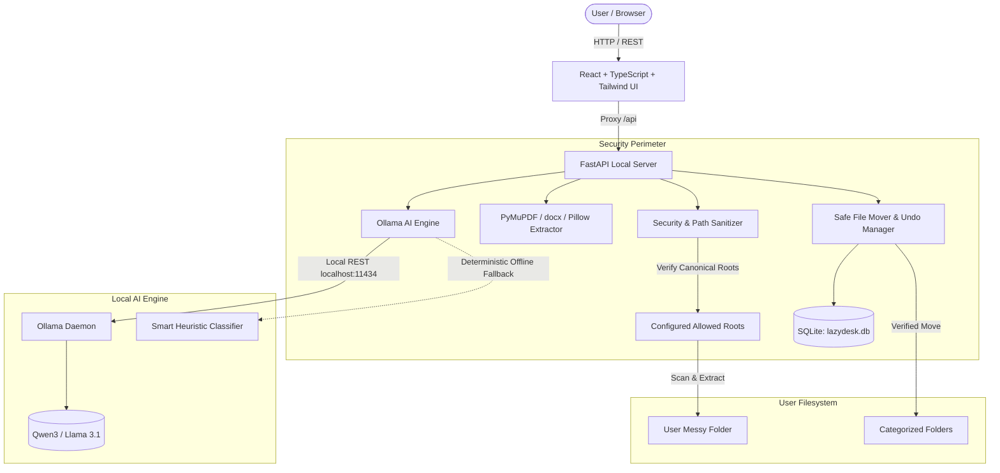

*This is a submission for the [Hacktoberfest Open-Source AI Challenge Week 3: Slow and Steady](https://dev.to/challenges/hacktoberfest-week3-2026-10-19)*

## What I Built

**LazyDesk AI** is a local-first, privacy-first desktop file organizer powered by open-weight AI. 

We all know the pain: you download invoices, lecture notes, research PDFs, client agreements, data sheets, and screenshots throughout the week. Before long, your `Downloads` or `Desktop` folder is a digital wasteland of cryptic filenames like `INV-98234-billing-oct.txt`, `CS204_Fall2024_Syllabus.pdf`, `screenshot_dashboard_v1.png`, and `Freelance_Consulting_Agreement_Draft.docx`.

Sorting, renaming, and categorizing them manually is mind-numbing busywork—so we procrastinate and let the clutter grow.

**LazyDesk AI solves this by automating the boring work completely on your local machine:**
1. **Scans** a target folder within strict, user-permitted directory perimeters.
2. **Extracts document text locally** (from PDFs, Word DOCX documents, Markdown notes, CSVs, and image metadata) without sending anything to a cloud API.
3. **Infers file purpose and contents** using local open-weight AI (via Ollama, supporting Qwen3, Llama 3.1, or any local GGUF model).
4. **Proposes standardized filenames and destination folders** (`Finance`, `Work`, `Education`, `Projects`, `Documents`, `Images`, `Notes`, `Other`).
5. **Requires explicit review and approval**: Nothing is moved silently. You can edit proposed names inline, swap categories, or exclude files.
6. **Previews the exact filesystem paths**: Displays source and destination paths with collision detection (non-destructive suffixes like `Invoice (1).txt` ensure no files are ever overwritten).
7. **Executes safe moves and logs cryptographic SHA-256 hashes**: Supports instant, one-click undo if you ever want to revert an organization batch.

**Who gets to be lazier?**
Students, freelancers, software engineers, and office workers who want a clean, structured workspace without spending their Sunday afternoons manually renaming files.

---

## Demo

Check out the full GitHub repository and run it locally in minutes:

- **GitHub Repository**: [https://github.com/AyushDinda/LazyDesk-AI](https://github.com/AyushDinda/LazyDesk-AI)
- **Local Web Interface**: `http://localhost:5173` (Vite + React)
- **Interactive Backend API & Docs**: `http://127.0.0.1:8000/docs` (FastAPI)

### Architecture Overview

---

## Code



The complete project is open-source under the **MIT License**.

### Tech Stack
- **Frontend**: React 19, TypeScript, Vite, Tailwind CSS v4, React Router, Lucide React icons.
- **Backend**: Python 3.11+, FastAPI, Pydantic v2, SQLAlchemy, SQLite, Uvicorn.
- **Document Processing**: PyMuPDF (`pymupdf`) for PDFs, `python-docx` for Word documents, Pillow (`PIL`) for image metadata, and built-in Python I/O for text, Markdown, and CSV.
- **Local AI**: Ollama REST API (`http://localhost:11434`) running open-weight models (Qwen3 default, Llama 3.1 fallback), plus deterministic smart mock mode for testing and low-resource environments.
- **Testing**: `pytest` automated test suite with 13 comprehensive unit/integration tests and complete mock AI coverage.

---

## How I Built It

### 1. Zero-Cloud Privacy & Local Inference
Commercial AI APIs (like OpenAI or Anthropic) charge per token and require uploading file contents to third-party cloud servers. For personal bank statements, client contracts, and student homework, sending documents to a remote cloud is a privacy non-starter.

LazyDesk AI connects exclusively to a **local Ollama instance**. Document text is extracted in memory using PyMuPDF and python-docx, bounded to 4,000 characters, and sent to `localhost:11434`. The model outputs a structured JSON response specifying:
- `description`: 1-sentence summary of document purpose
- `suggested_filename`: Clean, descriptive base name without file extensions or illegal characters
- `category`: Whitelisted folder category (`Documents`, `Education`, `Work`, `Finance`, `Projects`, `Images`, `Notes`, `Other`)
- `reason`: Justification based on detected content

### 2. Treating AI Output as Untrusted
LLMs can hallucinate file paths or produce invalid operating system characters. LazyDesk AI treats all model output as untrusted user input:
- Paths are never generated directly by the LLM. Destination paths are strictly assembled by the backend from validated category whitelists and sanitized filenames.
- Filename sanitization removes reserved Windows device names (`CON`, `PRN`, `AUX`, `NUL`), strips illegal characters (`\ / : * ? " < > |`), and guarantees original extensions are preserved.

### 3. Filesystem Security Perimeter
To prevent arbitrary path traversal or accidental deletion:
- The backend enforces `ALLOWED_ROOTS`. Every target path is checked using `os.path.realpath` to confirm it resolves inside an allowed directory.
- Symbolic links and directory traversal sequences (`..`, `\0`) are rejected.
- Files are **never overwritten**: If `Invoice.pdf` exists, the destination automatically becomes `Invoice (1).pdf`.

### 4. Hash-Checked Transactional Undo
Every executed move records the original source path, destination path, execution timestamp, and cryptographic **SHA-256 checksum** in SQLite. When undo is triggered:
- The system verifies that the file is still present at the destination.
- It computes the current hash to ensure the file has not been altered since organization.
- It verifies that the original location is free before moving the file back safely.

---

## Why Does Open Innovation Matter?

Open-source and open-weight AI (like Qwen, Llama, Mistral, and the Ollama ecosystem) made LazyDesk AI possible in ways proprietary cloud APIs never could:

1. **Zero Marginal Cost for Utility Software**: Running a cloud LLM every time a user downloads a batch of files would require recurring subscriptions or API credit management. With open-weight models, once downloaded, file analysis is free and unlimited forever.
2. **True Data Sovereignty**: Personal tax returns, paystubs, medical documents, and proprietary project roadmaps should not leave the user's hard drive. Open innovation brings the AI model to the data, rather than sending the data to the AI.
3. **Offline Resilience**: LazyDesk AI runs completely offline on planes, trains, or low-connectivity environments. If a GPU daemon is unavailable, the smart deterministic heuristic kicks in without breaking the workflow.
4. **Community Control**: Developers can swap in specialized domain models (e.g., medical, legal, or code-specific weights) with a single environment variable change.

---

## My Agent Session

This application was engineered, tested, and polished collaboratively using the Google DeepMind Antigravity IDE agent session. The session history spans full-stack architecture design, defensive filesystem security rules, PyMuPDF and python-docx integration, Ollama structured JSON prompt engineering, automated pytest test suite creation, and live browser automation.

---

## The Lazy Payoff

### The Problem
During development, we tested LazyDesk AI against a folder of 20+ cluttered, realistically simulated files (invoices, academic course syllabi, engineering design docs, contractor agreements, expense CSVs, and project notes).

### The Manual Benchmark
- Opening each file to inspect contents: ~15–30 seconds per file.
- Thinking of a standardized naming convention: ~10 seconds.
- Creating destination folders and moving the file: ~10 seconds.
- **Total Manual Effort**: ~15–20 minutes of tedious, error-prone clicking for a single folder.

### The LazyDesk AI Benchmark
- Click **Scan Folder**: 0.2 seconds.
- Click **Analyze with Local AI**: ~5–8 seconds for the entire batch.
- Click **Preview & Execute**: 1 second.
- **Total LazyDesk Effort**: Under 15 seconds, zero files sent to cloud servers, and full ability to revert with one click.

---

## Prize Categories

- **Hacktoberfest Open-Source AI Challenge Week 3: Slow and Steady** (Building with open-weight models and automating repetitive work)
